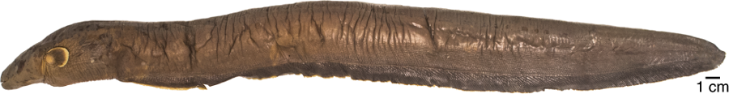
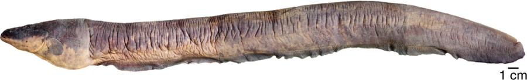
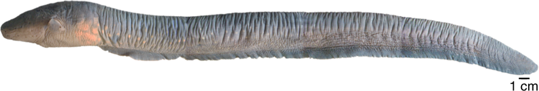
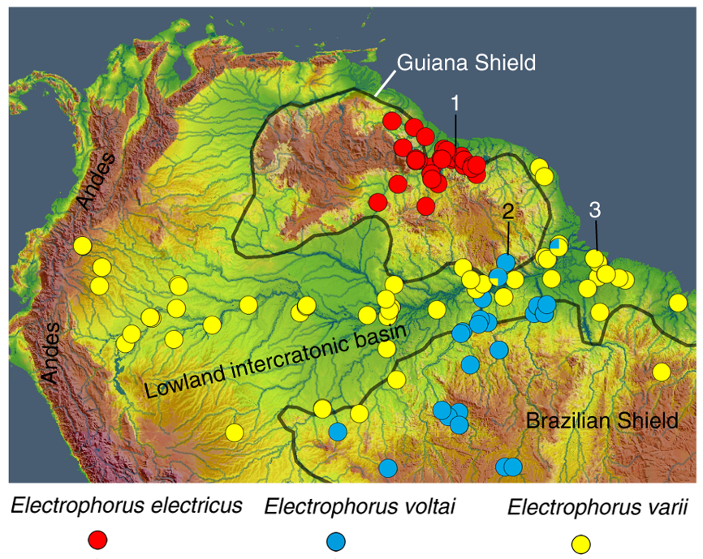

# Espèces

Le genre *Electrophorus* regroupe les poissons communément appelés
« anguilles électriques ».

Pendant environ deux siècles et demi, une seule espèce était reconnue :
*Electrophorus electricus*. Une étude publiée en 2019, fondée sur des
données génétiques, morphologiques et écologiques, a cependant montré
l’existence de trois lignées distinctes correspondant à trois espèces.[^1]

FishBase reconnaît actuellement trois espèces dans le genre
*Electrophorus* : *E. electricus*, *E. voltai* et *E. varii*.[^2]

## Les trois espèces

### *Electrophorus electricus*

*Electrophorus electricus* est l’espèce historiquement décrite sous le nom
d’« anguille électrique ».[^1]

Elle peut atteindre une longueur d’environ 2,5 mètres selon FishBase.[^2]

### *Electrophorus voltai*

*Electrophorus voltai* a été décrite comme espèce distincte en 2019.[^1]

Lors des travaux ayant conduit à sa description, un spécimen a produit
une décharge mesurée à **860 volts**, soit une valeur supérieure aux
décharges précédemment rapportées chez les anguilles électriques.[^1]

Cette mesure a conduit les auteurs à la présenter comme le plus puissant
générateur bioélectrique vivant connu au moment de l’étude.[^1]

### *Electrophorus varii*

*Electrophorus varii* a également été décrite comme espèce distincte en
2019.[^1]

Elle fait partie des trois espèces actuellement reconnues dans le genre
*Electrophorus*.[^2]

## Représentations visuelles

> Les trois espèces du genre *Electrophorus* présentent une apparence
> générale proche. Les images ci-dessous servent à représenter chaque
> espèce, mais leur distinction ne repose pas uniquement sur des
> caractères visibles à l’œil nu.[^1]

### *Electrophorus electricus*

*Représentation de* **Electrophorus electricus** *.[^3]*

### *Electrophorus voltai*

*Représentation de* **Electrophorus voltai** *.[^4]*

### *Electrophorus varii*

*Représentation de* **Electrophorus varii** *.[^5]*

## Comparaison rapide

| Espèce | Année de description / reconnaissance | Longueur maximale indiquée par FishBase |
| --- | ---: | ---: |
| *E. electricus* | 1766 | 250 cm |
| *E. voltai* | 2019 | 171,1 cm |
| *E. varii* | 2019 | 148,5 cm |

Les valeurs de longueur ci-dessus proviennent de FishBase.[^2]
## Répartition géographique

*Localités d’échantillonnage utilisées dans l’étude de 2019.  
Rouge :* **E. electricus** ; *bleu :* **E. voltai** ; *jaune :* **E. varii**.[^6]

La répartition observée met en évidence une différenciation géographique
importante entre les trois espèces. *Electrophorus electricus* est associé
principalement au bouclier guyanais, tandis que *E. voltai* est notamment
présent dans des cours d’eau liés au bouclier brésilien. *E. varii* est,
quant à lui, largement représenté dans les basses terres du bassin
amazonien.[^1]

## Une diversité longtemps invisible

Les trois espèces présentent une apparence générale suffisamment proche
pour que cette diversité soit restée longtemps méconnue.[^1]

L’étude de 2019 s’est appuyée sur plusieurs types de données afin de
distinguer les différentes lignées, notamment :

- la génétique ;
- la morphologie ;
- l’écologie ;
- la répartition géographique.[^1]

Cette découverte montre qu’un animal de grande taille, étudié depuis
plusieurs siècles et très connu pour une caractéristique aussi spectaculaire
que la production de fortes décharges électriques, peut encore révéler une
diversité biologique jusque-là passée inaperçue.[^1]

## Références

[^1]: de Santana, C. D., Crampton, W. G. R., Dillman, C. B. et al. (2019). *Unexpected species diversity in electric eels with a description of the strongest living bioelectricity generator*. **Nature Communications**, 10, 4000. https://doi.org/10.1038/s41467-019-11690-z

[^2]: FishBase. *Electrophorus* — liste des espèces du genre. https://www.fishbase.se/identification/SpeciesList.php?genus=Electrophorus

[^3]: Source de l’image de *Electrophorus electricus* à préciser.

[^4]: Source de l’image de *Electrophorus voltai* à préciser.

[^5]: Source de l’image de *Electrophorus varii* à préciser.# Espèces

